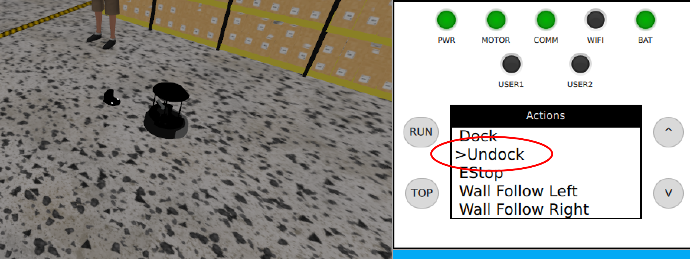
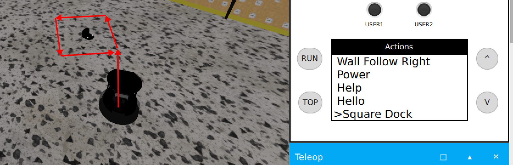

# ROS2 Playground

I use this repo to learn the [ROS2 framework](https://docs.ros.org/en/rolling/index.html).

## Build and run

### Nix
I used the nix package manager to setup Ros2 via the magnificant project
[nix-ros-overlay](https://github.com/lopsided98/nix-ros-overlay).
If you are also using nix, you should be able bulid the project on any machine
by running just the commands:

```bash
cd ~
git clone --recurse-submodules git@github.com:QHeiler/ros2_playground.git
source rosinit.sh
colcon build
```

In order to run the simulation afterwards, **open up a new shell** and within
that, run:
```bash
ros2 launch turtlebot4_gz_bringup turtlebot4_gz.launch.py
```

### Non-nix
If you don't use nix, but already have ROS2 configured on your system,
you can just run:
```bash
git clone --recurse-submodules git@github.com:QHeiler/ros2_playground.git
```
to checkout the Repo and then use **rosdep** and **colcon** in the usual
way to build the project.

### Firewall rules!
The gazebo plugin relies on UDP-multicast messages. If your firewall configuration
blocks multicast messages, this problem be can quite painful to troubleshoot.
The ROS2 documentation mentions this [only briefly](https://docs.ros.org/en/foxy/How-To-Guides/Installation-Troubleshooting.html#enable-multicast).
Especially on NixOS, mutlicast seems to be blocked by default.
The firewalls rules in NixOS can be adjusted using [iptables](https://man7.org/linux/man-pages/man8/iptables.8.html).

## Square Dock action for turtlebot4
By default turtlebot4 provides two "docking behaviours": Dock and Undock.
I added a third functionality "Square Dock" to the turtlebot4 simulation.
That let's the robot drive on a square line around the docking station.
This function is advertised via an action server and available in the
via the gazebo plugin.

### How to use

1. Start the gazebo simulation of turtlebot4.

```bash
ros2 launch turtlebot4_gz_bringup turtlebot4_gz.launch.py
```

2. Undock the robot via the Menu Option "Undock".



3. Drive around a bit. When the robot has clear sight of the front of the docking station, use the "Square Dock" button and watch the Robot drive on a square around the dock.



